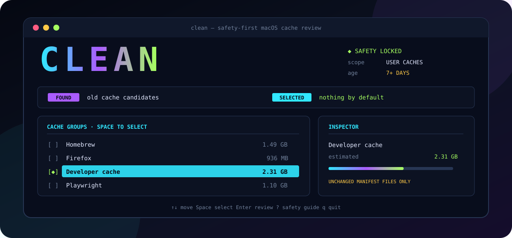

<div align="center">
  
  <h1>CLEAN</h1>
  <p><strong>A beautiful cache cleaner that treats deletion like a security boundary.</strong></p>
  <p>
    <a href="https://github.com/Gianlz/CLEAN/actions/workflows/ci.yml"></a>
    <a href="https://github.com/Gianlz/CLEAN/actions/workflows/codeql.yml"></a>
    
    
    
    
  </p>
</div>

CLEAN is a native macOS terminal application for reviewing and removing old, user-owned cache files. Its interface is intentionally lavish; its authority is intentionally narrow.

It scans before it acts, selects nothing automatically, requires an exact typed confirmation, and removes only files that still match the reviewed manifest.

## Why CLEAN

Most cleanup tools optimize for the largest possible number. CLEAN optimizes for an answerable question: **exactly what was authorized, and exactly what happened to it**.

- Read-only discovery before every cleanup.
- Fixed user-cache roots instead of arbitrary paths.
- Seven-day protection for recently modified files.
- One-file-at-a-time deletion anchored to no-follow directory descriptors.
- Fresh metadata validation immediately before every removal.
- Honest receipts for removed, skipped, changed, and inaccessible entries.
- No administrator privileges, telemetry, network access, or background daemon.

## Quick start

Build the pinned source release:

```sh
git clone https://github.com/Gianlz/CLEAN.git
cd CLEAN
cargo build --release --locked
./target/release/clean
```

Or install the checked-out source into Cargo's binary directory:

```sh
cargo install --path . --locked
clean
```

The [Releases page](https://github.com/Gianlz/CLEAN/releases) contains versioned Apple-silicon archives after the first semantic version tag is published.

## Read-only commands

These commands cannot enter the deletion flow:

```sh
clean doctor
clean scan --dry-run
clean scan --dry-run --include-recent
```

`doctor` validates the current-account safety posture and fixed roots. `scan --dry-run` produces a plain-text recovery estimate suitable for scripts and non-interactive terminals.

## Safety model

| Boundary | Behavior |
|---|---|
| Scope | Only `~/Library/Caches` and `~/.cache` |
| Privileges | Current user only; execution as root is refused |
| Default age | Files modified at least seven days ago |
| Selection | Nothing selected automatically |
| Files | Regular, single-link files on the cache root's filesystem |
| Links | Symlinks and hard-linked files are skipped |
| Deletion | Exact manifest entries only; no recursive directory removal |
| Revalidation | Device, inode, size, link count, type, and modification time |
| Confirmation | Exact phrase `DELETE <count> FILES` |
| Cancellation | Stops safely between individual files |
| Privacy | No network, telemetry, persistent manifest, or background service |

The guarantee is deliberately narrow. CLEAN guarantees the tested containment and confirmation behavior above for supported builds. It cannot guarantee that third-party software always treats cache contents as disposable, that macOS grants access to every cache, or that available space changes by precisely the sum of file sizes.

For the threat model and invariants, read [the safety model](docs/SAFETY_MODEL.md). For component boundaries, read [the architecture guide](docs/ARCHITECTURE.md).

## Controls

| Key | Action |
|---|---|
| `↑` `↓` or `j` `k` | Move through cache groups |
| `Space` | Select or deselect a group |
| `a` | Select all or clear all |
| `Enter` | Continue to confirmation or scan again |
| `i` | Toggle the recent-file override and rescan |
| `r` or `s` | Run a fresh read-only scan |
| `?` | Open the in-app safety guide |
| `Esc` | Go back or cancel safely |
| `q` | Quit |
| `Ctrl-C` | Restore the terminal; during cleanup, stop between files |

Set `NO_COLOR=1` for a monochrome interface. Set `CLEAN_REDUCE_MOTION=1` to disable animation.

## Development

The repository pins its minimum Rust toolchain and committed dependency graph.

```sh
cargo fmt --all --check
cargo clippy --locked --all-targets --all-features -- -D warnings
cargo test --locked --all-targets
cargo build --locked --release
```

Destructive integration tests use temporary fixture directories. Tests and pull-request review must never delete real user cache data.

See [CONTRIBUTING.md](CONTRIBUTING.md) for the contribution workflow and [RELEASING.md](RELEASING.md) for the signed release process.

## Project scope

CLEAN currently targets Apple-silicon macOS. Trash, Downloads, logs, Application Support, system caches, browser profiles, elevated cleanup, automatic process termination, scheduling, and arbitrary cleanup paths remain intentionally outside the safety boundary.

## Community and security

- General help: [SUPPORT.md](SUPPORT.md)
- Vulnerability reporting: [SECURITY.md](SECURITY.md)
- Expected behavior: [CODE_OF_CONDUCT.md](CODE_OF_CONDUCT.md)
- Decision process: [GOVERNANCE.md](GOVERNANCE.md)
- Release history: [CHANGELOG.md](CHANGELOG.md)

## License

CLEAN is available under the [MIT License](LICENSE).
