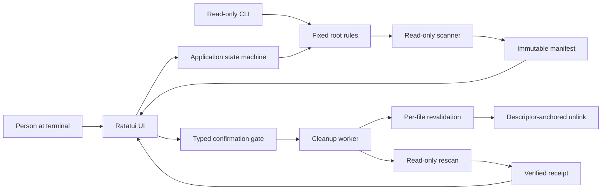
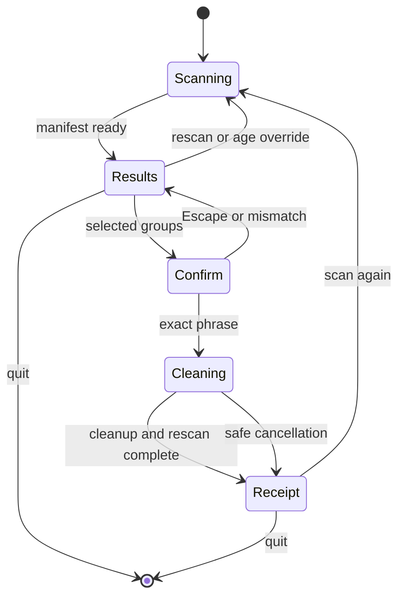

# Architecture

CLEAN separates terminal presentation from filesystem authority. The interface can request operations, but only the rules, scanner, safety validator, and cleaner can produce a deletion.

## Modules

| Module | Responsibility | Forbidden authority |
|---|---|---|
| `main.rs` | Terminal lifecycle, event polling, panic restoration | Cleanup policy |
| `cli.rs` | Argument parsing and read-only diagnostics | Interactive or direct deletion command |
| `app.rs` | UI state machine, workers, selection, confirmation input | Raw filesystem deletion |
| `ui.rs` | Rendering, layouts, accessibility fallbacks | Filesystem access |
| `theme.rs` | Color and animation tokens | Application state changes |
| `rules.rs` | Current-account resolution and exact root construction | Arbitrary path input |
| `scanner.rs` | Non-following traversal and manifest construction | Mutation |
| `safety.rs` | Identity checks and descriptor-relative removal | Policy expansion |
| `cleaner.rs` | Selected-manifest orchestration and receipt accounting | Recursive directory removal |
| `report.rs` | Human-readable sizes and result types | Filesystem access |

## State flow

Nothing is preselected after scanning. Confirmation consent applies to the identities in that specific manifest, not to whatever paths contain later.

## Concurrency

The terminal event loop owns `App` and rendering. Scan and cleanup work run on background threads and communicate through standard-library channels. Cancellation uses an atomic flag.

The cleanup worker performs a fresh scan before returning its receipt. This keeps the final screen tied to observable post-operation state instead of trusting requested work.

## Dependency policy

- `ratatui` handles deterministic terminal layout and widgets.
- `crossterm` handles terminal events, raw mode, and alternate-screen control.
- `uzers` resolves the current system account independently of an untrusted `HOME` value.
- `libc` supplies the macOS descriptor-relative filesystem operations unavailable in the Rust standard library.
- `tempfile` is test-only and confines destructive verification to disposable directories.

Dependencies are locked, minimized, updated through reviewable pull requests, and tested on the minimum supported compiler.
